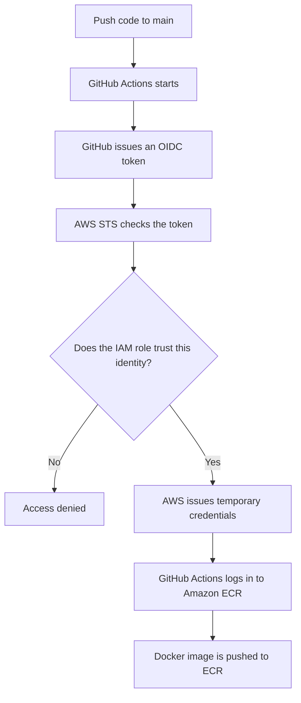

# OIDC Explained in Simple English
🌐 **English** | [简体中文](oidc-simple-explanation.zh-CN.md)
> **A beginner-friendly guide to OpenID Connect, using GitHub Actions and AWS ECR as a real-world example.**

**Language:** English · **Topics:** OIDC, JWT, AWS IAM, STS, GitHub Actions, Amazon ECR

## 1. What Is OIDC?

**OIDC** stands for **OpenID Connect**.

In simple words, **OIDC is a way for one system to prove its identity to another system using a trusted identity provider.**

For our CI/CD example, OIDC lets **GitHub Actions prove its identity to AWS without storing a long-term AWS access key in GitHub**.

**Remember:** OIDC helps prove **who you are**. AWS IAM then determines **what you are allowed to do**.

## 2. Think of Checking Into a Hotel

Imagine you are checking into a hotel:

1. You show a trusted identity document at the front desk.
2. The hotel checks that the document is genuine and that you are allowed to check in.
3. The hotel gives you a **temporary room key card**.
4. The card opens only the rooms you are allowed to enter.

In a GitHub-to-AWS deployment, the same idea works like this:

| Hotel example | GitHub Actions → AWS |
| --- | --- |
| Guest | GitHub Actions workflow |
| Trusted ID issuer | GitHub OIDC provider |
| Identity document | OIDC ID token |
| Hotel front desk | AWS Security Token Service (STS) |
| Check-in rules | IAM role trust policy |
| Temporary room key | Temporary AWS credentials |
| Doors the card can open | AWS permissions, such as access to ECR |

**Important:** The OIDC token is *not* the temporary AWS key. AWS checks the token first and then may issue **separate, temporary AWS credentials**.

## 3. How Does OIDC Work With GitHub Actions and AWS?



### Step by step

1. **You push code to GitHub.** A workflow runs on the `main` branch.
2. **GitHub issues an OIDC token.** It contains claims describing the workflow's identity.
3. **GitHub Actions asks AWS STS to assume a role.** It sends the token in an `AssumeRoleWithWebIdentity` request.
4. **AWS checks the token and trust policy.** AWS checks the token's signature, issuer, audience, and subject conditions.
5. **AWS returns temporary credentials** if the request is allowed.
6. **The workflow uploads the Docker image** using those credentials and the role's permissions.

No long-term AWS access key has to be saved as a GitHub secret.

## 4. What's Inside an OIDC Token?

An OIDC token is usually a **JWT (JSON Web Token)**. A simplified example is:

```json
{
  "iss": "https://token.actions.githubusercontent.com",
  "aud": "sts.amazonaws.com",
  "sub": "repo:WUJINXIN/game-leaderboard-api:ref:refs/heads/main"
}
```

| Claim | Full name | Simple meaning |
| --- | --- | --- |
| `iss` | Issuer | **Who issued this ID?** |
| `aud` | Audience | **Who is this ID meant for?** |
| `sub` | Subject | **Which identity or workflow does it represent?** |

**Note:** This `sub` is an illustrative *traditional* GitHub subject format. The real format can differ depending on GitHub's current defaults and repository customization, including immutable repository/owner identifiers. Always verify the actual token claims before writing the AWS trust policy. Never print a live token into public CI logs.

## 5. OIDC vs IAM Role vs STS

These terms are related, but they do different jobs:

| Component | Hotel analogy | Job |
| --- | --- | --- |
| **OIDC** | Identity document system | Helps prove identity |
| **IAM role trust policy** | Check-in rules | Decides **who may assume the role** |
| **IAM permissions policy** | Which doors a card opens | Decides **what AWS actions are allowed** |
| **AWS STS** | Front desk | Issues temporary AWS credentials |
| **Amazon ECR** | Storage room | Stores Docker images |

For example, a role named `GitHubActionsECRPushRole` can be configured so that:

- Only an approved workflow identity from `WUJINXIN/game-leaderboard-api` on `main` can assume it.
- The role can push images only to `game-leaderboard-api` in AWS Sydney (`ap-southeast-2`), apart from API calls such as ECR authorization that require a broader resource scope.

The **trust policy** and the **permissions policy** are both important.

## 6. Why Is OIDC Better Than a Long-Term Access Key?

| Long-term AWS access key | OIDC + AWS STS |
| --- | --- |
| A reusable secret is stored in CI settings | No reusable AWS access key needs to be stored |
| May remain valid for a long time | AWS credentials expire after a short period |
| Requires rotation and careful handling | Credentials are obtained when the job runs |
| A stolen key may be reused until revoked | Short-lived credentials limit the exposure window |

**OIDC is not magic security.** A malicious workflow or a role with overly broad permissions can still cause damage. Protect your main branch, review workflow changes, and follow the principle of least privilege.

## 7. A Small GitHub Actions Example

This example shows the AWS authentication step only, **not a complete deployment pipeline**.

```yaml
permissions:
  contents: read
  id-token: write

steps:
  - name: Configure AWS credentials
    uses: aws-actions/configure-aws-credentials@v6.3.0
    with:
      role-to-assume: ${{ secrets.AWS_ROLE_ARN }}
      aws-region: ap-southeast-2

  - name: Check identity
    run: aws sts get-caller-identity
```

Before running it, the AWS account must have:

1. An OIDC identity provider for `https://token.actions.githubusercontent.com` with audience `sts.amazonaws.com`.
2. An IAM role with an appropriately restricted trust policy.
3. An IAM permissions policy for the intended AWS operations.
4. A GitHub secret named `AWS_ROLE_ARN` containing the **IAM role ARN** (not a temporary STS session ARN).

For Docker push, additional ECR login, image build, and push steps are needed.

## 8. Common Questions

**Q: Is OIDC the same as an AWS access key?**  
No. An OIDC token is used to prove identity. AWS STS can then issue temporary AWS access credentials.

**Q: Does GitHub get administrator access automatically?**  
No. AWS only grants permissions attached to the role, subject to all applicable policy restrictions.

**Q: Can any GitHub repository use my AWS role?**  
Not if the trust policy correctly limits the token's subject, audience, and other supported conditions.

**Q: Is Amazon ECR part of OIDC?**  
No. ECR stores container images. OIDC is one way for a workflow to authenticate before calling AWS APIs.

**Q: What is the difference between an IAM role ARN and an STS assumed-role ARN?**  
The IAM role ARN identifies the role you configure. An STS assumed-role ARN identifies a temporary session using that role.

## 9. Interview Answer (Simple English)

> **“OIDC lets GitHub Actions prove its identity to AWS without storing long-term AWS access keys. AWS verifies the OIDC token through STS and, if the IAM role trust policy allows it, issues temporary credentials. The workflow then uses those credentials to push a Docker image to Amazon ECR.”**

## 10. One-Sentence Summary

**OIDC proves who the workflow is; IAM decides what it can do; STS provides temporary credentials.**

## References

- [GitHub Docs — OpenID Connect in AWS](https://docs.github.com/en/actions/how-tos/secure-your-work/security-harden-deployments/oidc-in-aws)
- [AWS IAM — Create an OpenID Connect identity provider](https://docs.aws.amazon.com/IAM/latest/UserGuide/id_roles_providers_create_oidc.html)
- [AWS STS — AssumeRoleWithWebIdentity](https://docs.aws.amazon.com/STS/latest/APIReference/API_AssumeRoleWithWebIdentity.html)
- [Amazon ECR — Pushing a Docker image](https://docs.aws.amazon.com/AmazonECR/latest/userguide/docker-push-ecr-image.html)

---

*Learning notes for the `game-leaderboard-api` CI/CD project. Confirm current provider, action, and token details against official documentation before production use.*
