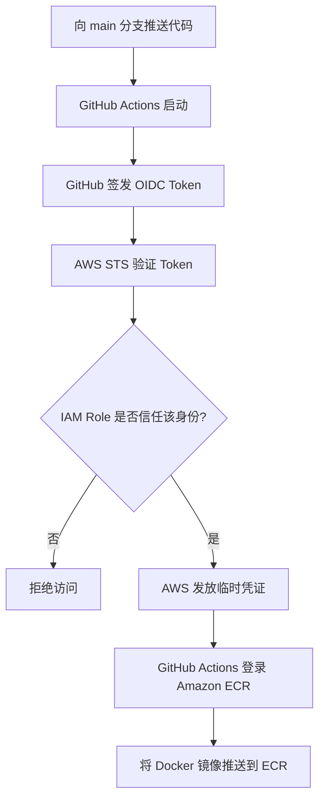

# OIDC 是什么？大白话讲解

> **面向初学者的 OpenID Connect 入门笔记，以 GitHub Actions 和 AWS ECR 为实际案例。**

**语言：** 简体中文 · **主题：** OIDC、JWT、AWS IAM、STS、GitHub Actions、Amazon ECR

[English Version](oidc-simple-explanation.md)

## 1. OIDC 是什么？

**OIDC** 的全称是 **OpenID Connect（开放身份认证协议）**。

用大白话说，**OIDC 让一个系统借助可信的身份提供者，向另一个系统证明“我是谁”。**

在我们的 CI/CD 案例中，OIDC 让 **GitHub Actions 无需在 GitHub 中保存长期有效的 AWS Access Key，也能向 AWS 证明自己的身份**。

**记住：** OIDC 主要帮助证明 **“你是谁”**；AWS IAM 再决定 **“你可以做什么”**。

## 2. 用酒店入住来理解

想象一下，你去酒店办理入住：

1. 你向前台出示可信的身份证明。
2. 酒店确认身份证明真实，并检查你是否有入住资格。
3. 酒店给你一张**临时房卡**。
4. 这张房卡只能打开你有权限进入的房间。

GitHub 向 AWS 部署时，也可以这样理解：

| 酒店场景 | GitHub Actions → AWS |
| --- | --- |
| 住客 | GitHub Actions 工作流 |
| 可信的证件签发方 | GitHub OIDC Provider（身份提供者） |
| 身份证明 | OIDC ID Token（身份令牌） |
| 酒店前台 | AWS Security Token Service（STS） |
| 入住资格规则 | IAM Role Trust Policy（信任策略） |
| 临时房卡 | AWS 临时凭证 |
| 房卡能打开的门 | AWS 权限，例如访问 ECR |

**重要：** OIDC Token **不是** AWS 临时访问密钥。AWS 会先检查 Token，符合条件后才可能另外发放一组**临时 AWS 凭证**。

## 3. OIDC 如何配合 GitHub Actions 和 AWS 工作？



### 分步骤解释

1. **向 GitHub 推送代码。** `main` 分支的工作流被触发。
2. **GitHub 签发 OIDC Token。** Token 中有描述该工作流身份的字段（Claims）。
3. **GitHub Actions 请求 AWS STS 扮演一个 IAM Role。** 它通过 `AssumeRoleWithWebIdentity` 请求提交 Token。
4. **AWS 验证 Token 和 Trust Policy。** 检查签名、签发方（Issuer）、接收方（Audience）和主体（Subject）等条件。
5. **如果验证与授权通过，AWS 返回临时凭证。**
6. **工作流使用这些临时凭证和 Role 权限上传 Docker 镜像。**

整个过程中，不需要把长期有效的 AWS Access Key 保存成 GitHub Secret。

## 4. OIDC Token 里有什么？

OIDC Token 通常是一种 **JWT（JSON Web Token）**。下面是一个简化示例：

```json
{
  "iss": "https://token.actions.githubusercontent.com",
  "aud": "sts.amazonaws.com",
  "sub": "repo:WUJINXIN/game-leaderboard-api:ref:refs/heads/main"
}
```

| 字段 | 英文全称 | 大白话解释 |
| --- | --- | --- |
| `iss` | Issuer | **谁签发了这张身份证明？** |
| `aud` | Audience | **这张证明是给谁看的？** |
| `sub` | Subject | **证明代表哪个身份或工作流？** |

**注意：** 这里的 `sub` 采用了传统 GitHub 格式，仅用于说明概念。实际格式可能因 GitHub 默认规则或仓库自定义设置而不同，也可能包含不可变的 Owner ID、Repository ID。编写 AWS Trust Policy 前，应确认真实 Token 的 Claims。**不要在公开的 CI 日志中输出完整的真实 Token。**

## 5. OIDC、IAM Role 和 STS 有什么区别？

它们相互配合，但职责不同：

| 组件 | 酒店类比 | 负责什么 |
| --- | --- | --- |
| **OIDC** | 身份证明体系 | 帮助证明身份 |
| **IAM Role Trust Policy** | 入住资格规则 | 决定**谁可以扮演 Role** |
| **IAM Permissions Policy** | 房卡能打开哪些门 | 决定**允许执行哪些 AWS 操作** |
| **AWS STS** | 酒店前台 | 发放临时 AWS 凭证 |
| **Amazon ECR** | 仓库 | 保存 Docker 镜像 |

例如，可以把 `GitHubActionsECRPushRole` 配置成：

- 只有 `WUJINXIN/game-leaderboard-api` 的 `main` 分支中符合条件的工作流身份才能扮演这个 Role。
- 该 Role 只能向悉尼区域（`ap-southeast-2`）的 `game-leaderboard-api` ECR 仓库推送镜像；不过像 ECR 登录授权这样的个别 API 操作需要更广的资源范围。

**Trust Policy（信任策略）**和**Permissions Policy（权限策略）**都非常重要。

## 6. 为什么 OIDC 比长期 Access Key 更适合 CI/CD？

| 长期有效的 AWS Access Key | OIDC + AWS STS |
| --- | --- |
| 往往需要在 CI 设置中保存可重复使用的密钥 | 不需要保存长期有效的 AWS Access Key |
| 密钥可能长期有效 | AWS 临时凭证会较快过期 |
| 需要妥善保管并定期轮换 | 工作流运行时才获取凭证 |
| 密钥泄露后，在撤销之前可能持续被滥用 | 临时凭证缩短了泄露后的可利用时间窗口 |

**OIDC 不是“用了就绝对安全”。** 如果工作流被恶意修改，或 IAM Role 的权限过大，仍然可能造成损失。应保护 `main` 分支、审查 Workflow 修改，并遵循 **Least Privilege（最小权限原则）**。

## 7. GitHub Actions 的简单示例

下面只演示 **AWS 身份认证步骤**，**不是完整的部署流水线**。

```yaml
permissions:
  contents: read
  id-token: write

steps:
  - name: Configure AWS credentials
    uses: aws-actions/configure-aws-credentials@v6.3.0
    with:
      role-to-assume: ${{ secrets.AWS_ROLE_ARN }}
      aws-region: ap-southeast-2

  - name: Check identity
    run: aws sts get-caller-identity
```

运行前，AWS 账户需要准备好：

1. OIDC Identity Provider：`https://token.actions.githubusercontent.com`，Audience 为 `sts.amazonaws.com`。
2. 设定了严格 Trust Policy 的 IAM Role。
3. 针对目标 AWS 操作的 IAM Permissions Policy。
4. 名为 `AWS_ROLE_ARN` 的 GitHub Secret，其中保存的是 **IAM Role ARN**，而不是临时 STS 会话 ARN。

若要实际执行 Docker Push，还需要增加 ECR 登录、镜像构建和上传等步骤。

## 8. 常见问题

**Q：OIDC 和 AWS Access Key 是一回事吗？**  
不是。OIDC Token 用于证明身份；AWS STS 验证后可以发放临时 AWS 访问凭证。

**Q：GitHub 使用 OIDC 后会自动获得管理员权限吗？**  
不会。实际权限来自 IAM Role 关联的权限策略，同时仍受其他适用策略限制。

**Q：任何 GitHub 仓库都能使用我的 AWS Role 吗？**  
如果 Trust Policy 正确限制 Token 的 Subject、Audience 等受支持条件，就不会允许任意仓库使用。

**Q：Amazon ECR 是 OIDC 的一部分吗？**  
不是。ECR 负责存储容器镜像；OIDC 只是工作流访问 AWS API 前可以使用的一种身份认证方式。

**Q：IAM Role ARN 与 STS Assumed-role ARN 有什么区别？**  
IAM Role ARN 标识你配置的 IAM 角色；STS Assumed-role ARN 标识某次临时扮演该角色的会话。

## 9. 技术面试回答（简单英语）

> **“OIDC lets GitHub Actions prove its identity to AWS without storing long-term AWS access keys. AWS verifies the OIDC token through STS and, if the IAM role trust policy allows it, issues temporary credentials. The workflow then uses those credentials to push a Docker image to Amazon ECR.”**

中文理解：OIDC 让 GitHub Actions 不用保存长期 AWS 密钥，也能向 AWS 证明身份。AWS 通过 STS 验证 OIDC Token，如果符合 IAM Role 的信任策略，就发放临时凭证。随后工作流用这些凭证将 Docker 镜像推送到 Amazon ECR。

## 10. 一句话总结

**OIDC 证明“工作流是谁”；IAM 决定“它能做什么”；STS 负责发放临时凭证。**

## 参考资料

- [GitHub Docs — OpenID Connect in AWS](https://docs.github.com/en/actions/how-tos/secure-your-work/security-harden-deployments/oidc-in-aws)
- [AWS IAM — Create an OpenID Connect identity provider](https://docs.aws.amazon.com/IAM/latest/UserGuide/id_roles_providers_create_oidc.html)
- [AWS STS — AssumeRoleWithWebIdentity](https://docs.aws.amazon.com/STS/latest/APIReference/API_AssumeRoleWithWebIdentity.html)
- [Amazon ECR — Pushing a Docker image](https://docs.aws.amazon.com/AmazonECR/latest/userguide/docker-push-ecr-image.html)

---

*本笔记用于 `game-leaderboard-api` CI/CD 学习项目。用于生产环境前，请再次核对官方文档中最新的 OIDC Provider、GitHub Action 版本和 Token 格式。*
