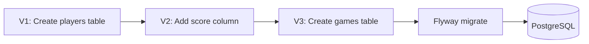
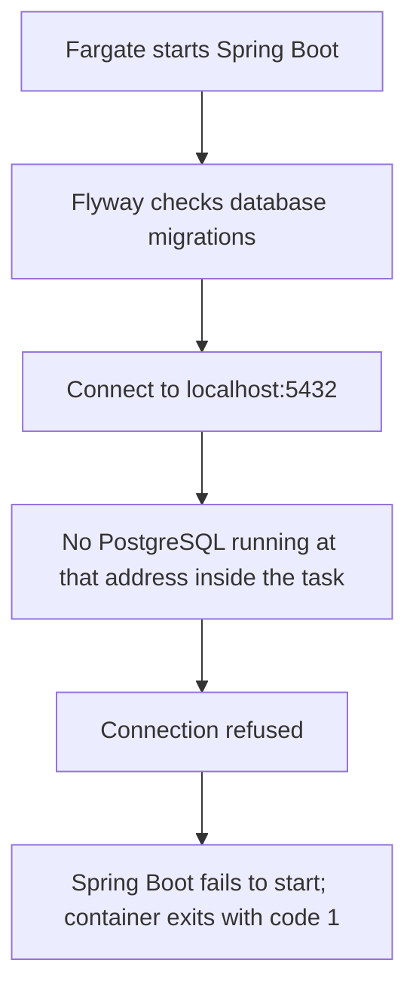
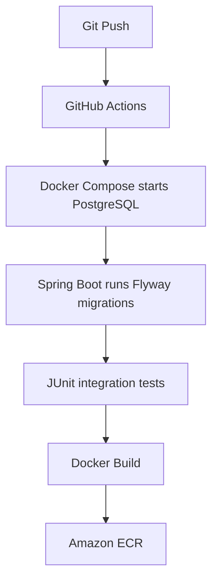

# Flyway Explained in Simple English

🌐 [简体中文](flyway.zh-CN.md) | **English**

> **In one sentence: Git tracks versions of your code; Flyway tracks changes to your database structure.**

## 1. Think of Renovating a House

Imagine your database is a house that you improve over time:

- **V1:** Build a kitchen — create the `players` table.
- **V2:** Add a cupboard — add a `score` column.
- **V3:** Build another room — create the `games` table.

Flyway is like a **step-by-step renovation plan**. A new environment can follow the same database changes in the right order.



## 2. How Does Flyway Work?

In a Spring Boot project, migration files typically live here:

```text
game-leaderboard-api/
└── src/main/resources/db/migration/
    ├── V1__create_players.sql
    ├── V2__add_score_column.sql
    └── V3__create_games.sql
```

These files are **learning examples**, not a verified list of your project's existing migrations. Check the real migration history before reusing version numbers.

**V1: Create a players table**

```sql
CREATE TABLE players (
    id BIGSERIAL PRIMARY KEY,
    name VARCHAR(100) NOT NULL
);
```

**V2: Add a score column**

```sql
ALTER TABLE players
ADD COLUMN score INTEGER NOT NULL DEFAULT 0;
```

**V3: Create a games table**

```sql
CREATE TABLE games (
    id BIGSERIAL PRIMARY KEY,
    player_id BIGINT NOT NULL REFERENCES players(id),
    score INTEGER NOT NULL
);
```

When Flyway runs, it checks which migrations have already been applied and executes the missing ones in the appropriate order. **It does not rebuild every table on every application startup.**

## 3. How Does Flyway Remember?

Flyway usually creates a table called `flyway_schema_history`.

| Version | Description | Success |
|---|---|---|
| 1 | create players | true |
| 2 | add score column | true |
| 3 | create games | true |

Think of it as a **renovation logbook**. If you later add `V4__add_player_email.sql`, Flyway uses the history to decide that V4 still needs to run.

Flyway also uses checksums and other metadata to detect changes to applied migrations. **Do not casually edit a versioned migration that has already run in shared environments.** Create a new migration instead.

## 4. A Real Example from Your ECS Fargate Deployment

Your `game-leaderboard-api` CloudWatch logs showed:

```text
Unable to obtain connection from database:
Connection to localhost:5432 refused
Error creating bean with name 'flywayInitializer'
Application run failed
```

What happened?



**Important:** `localhost` inside the Fargate task is not your MacBook. The application could not reach a PostgreSQL server at that address. This was a connectivity/configuration problem, not evidence of a broken migration script.

The next step is to use a PostgreSQL endpoint reachable from Fargate, passing the connection settings through deployment configuration:

```properties
spring.datasource.url=${DB_URL}
spring.datasource.username=${DB_USERNAME}
spring.datasource.password=${DB_PASSWORD}
```

Do not commit production passwords to GitHub. Use an appropriate secret management system, such as AWS Secrets Manager. Redis connectivity must also be configured separately.

## 5. How Do These Tools Work Together?

| Tool | Main responsibility |
|---|---|
| Git | Track code and configuration versions |
| Flyway | Track database schema changes |
| Docker | Package and run containers |
| Docker Compose | Run PostgreSQL, Redis, and other services in development or CI |
| GitHub Actions | Automate builds, tests, and publishing |

For example, your CI pipeline can work like this:



## 6. Practical Tips

- **A migration is not a backup.** Back up important data before risky changes.
- **Prefer new migrations over editing old ones.** This keeps shared environments consistent.
- **Read the real error.** A failure may be caused by network access, credentials, SQL mistakes, or version conflicts.
- **Plan for compatibility.** Removing a column or changing a large table may affect older application versions.
- **Do not assume automatic rollback.** Recovery depends on the database and migration strategy.

## 7. Key Takeaway

> **Git manages versions of your code. Flyway manages versions of your database schema.**
>
> For `game-leaderboard-api`, the next step is to give Fargate access to PostgreSQL so Flyway can initialize and Spring Boot can start successfully.
