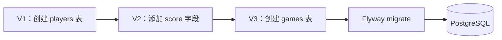
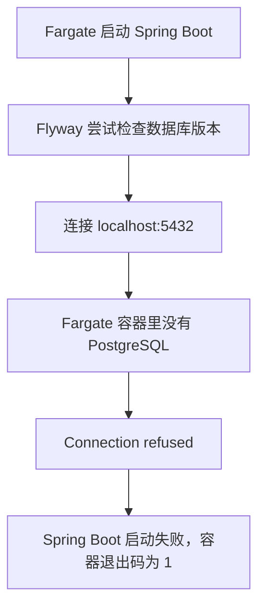
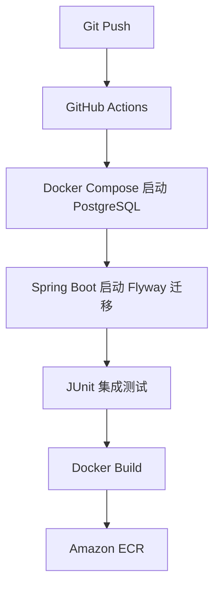

# Flyway 是什么？大白话讲解

🌐 **简体中文** | [English](flyway.en.md)

> **一句话：Git 管理代码版本，Flyway 管理数据库结构的变更版本。**

## 1. 用装修房子理解 Flyway

把数据库想象成一套房子：

- **V1**：建厨房——创建 `players` 表。
- **V2**：加储物柜——为 `players` 增加 `score` 字段。
- **V3**：再建一个房间——创建 `games` 表。

Flyway 就像一份**按顺序执行的装修施工计划**。换一个新环境，只要有同样的迁移文件，就能按相同顺序更新数据库结构。



## 2. Flyway 是怎么工作的？

在 Spring Boot 项目中，迁移文件通常放在：

```text
game-leaderboard-api/
└── src/main/resources/db/migration/
    ├── V1__create_players.sql
    ├── V2__add_score_column.sql
    └── V3__create_games.sql
```

以下是**教学示例**，不是你项目现有迁移文件的实际清单。已有数据库不能直接重用这些版本号，须先检查真实迁移历史。

**V1：创建玩家表**

```sql
CREATE TABLE players (
    id BIGSERIAL PRIMARY KEY,
    name VARCHAR(100) NOT NULL
);
```

**V2：增加积分字段**

```sql
ALTER TABLE players
ADD COLUMN score INTEGER NOT NULL DEFAULT 0;
```

**V3：增加游戏记录表**

```sql
CREATE TABLE games (
    id BIGSERIAL PRIMARY KEY,
    player_id BIGINT NOT NULL REFERENCES players(id),
    score INTEGER NOT NULL
);
```

Flyway 会检查数据库当前已经执行了哪些迁移，然后只执行尚未应用、且符合迁移顺序的文件。它**不会每次启动都重新创建所有表**。

## 3. 它怎么记得执行过什么？

Flyway 通常维护一张数据库表：`flyway_schema_history`。

| 版本 | 描述 | 执行成功 |
|---|---|---|
| 1 | create players | true |
| 2 | add score column | true |
| 3 | create games | true |

可以把它理解为装修工程的**施工记录本**。下次新添 `V4__add_player_email.sql`，Flyway 会根据记录决定需要执行 V4。

Flyway 还使用校验和（checksum）等信息检测已经执行的迁移是否被改动。因此：**共享环境已经执行过的版本化迁移，不应随意修改；通常应新增一个迁移文件。**

## 4. 你的 ECS Fargate 实际故障

在 `game-leaderboard-api` 部署到 AWS Fargate 后，CloudWatch Logs 出现：

```text
Unable to obtain connection from database:
Connection to localhost:5432 refused
Error creating bean with name 'flywayInitializer'
Application run failed
```

发生了什么？



**关键：Fargate 里的 `localhost` 指向 Fargate 任务自身的网络环境，并不是 MacBook。** 所以这不是 Flyway 的数据库迁移脚本出错，而是数据库根本连不上。

解决方向：为应用准备可从 Fargate 访问的 PostgreSQL 服务，并通过部署配置传入连接地址与凭证，例如：

```properties
spring.datasource.url=${DB_URL}
spring.datasource.username=${DB_USERNAME}
spring.datasource.password=${DB_PASSWORD}
```

不要把生产数据库密码提交到 GitHub；可使用 AWS Secrets Manager 等秘密管理方式。Redis 连接也需要单独配置。

## 5. Flyway 与其他工具怎么分工？

| 工具 | 负责什么 |
|---|---|
| Git | 管理代码和配置文件版本 |
| Flyway | 管理数据库结构迁移历史 |
| Docker | 打包和运行容器 |
| Docker Compose | 为本地或 CI 测试组织 PostgreSQL、Redis 等服务 |
| GitHub Actions | 自动执行构建、测试和发布 |

在你的 CI 中，流程可以是：



## 6. 实用注意事项

- **迁移是结构变更，不是备份。** 执行有风险的迁移前仍要准备备份。
- **旧迁移尽量不改。** 追加新文件更容易在多环境保持一致。
- **迁移失败不等于 Flyway 有 Bug。** 先看是数据库不可达、权限问题、SQL 错误还是版本冲突。
- **生产环境注意兼容性。** 删除字段、大表变更可能影响正在运行的旧版应用。
- **不要假定自动回滚。** 回滚能力取决于数据库、迁移类型和具体方案。

## 7. 最后记住

> **Git 给代码做版本管理，Flyway 给数据库结构做版本管理。**
>
> 对 `game-leaderboard-api` 而言，下一步是让 Fargate 能连接 PostgreSQL，才能在云端完成 Flyway 初始化并正常启动 Spring Boot。
