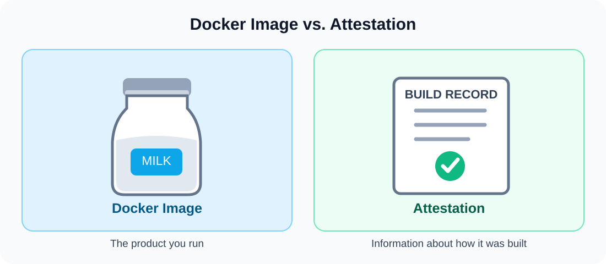
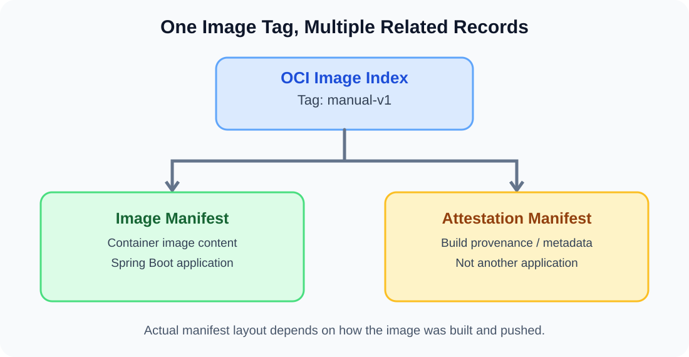
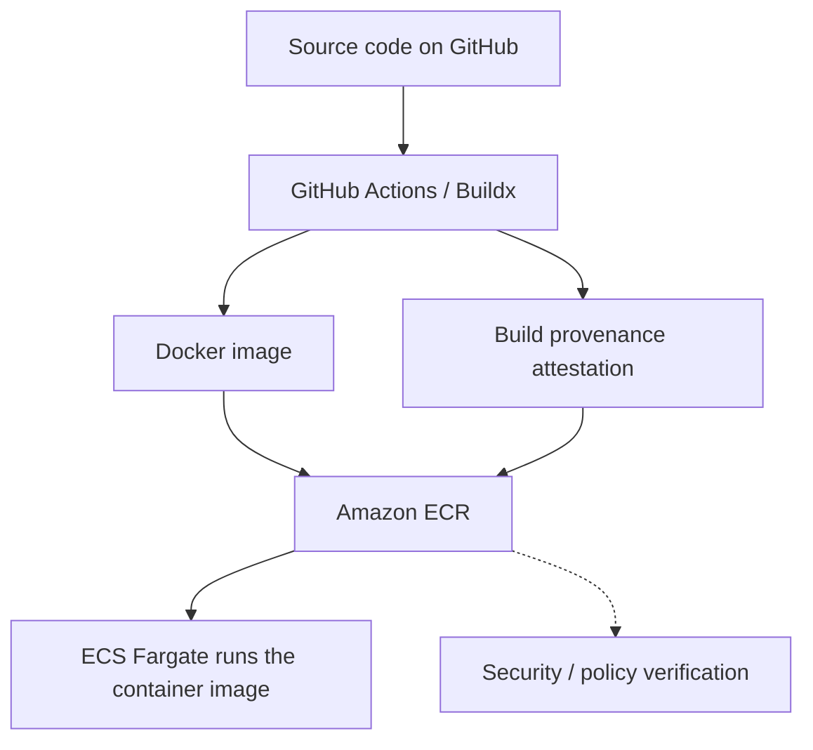

# Docker Attestation — A Simple Explanation

> **In one sentence:** A Docker attestation is like a production record for a container image: it can tell us where the image came from and how it was built.



## 1. What Is Attestation?

**Attestation** means a statement or record that provides evidence about something.

In the Docker ecosystem, an attestation is metadata associated with a container image. For example, a **build provenance attestation** can describe how an image was created.

Think of it this way:

- **Docker image:** The actual software product you run.
- **Attestation:** A record describing how that product was built.
- **Amazon ECR:** A registry that can store the image and its associated metadata.

> **Important:** An attestation is not automatically a trusted certificate. Its claims must be checked, and where applicable, their source and signature must be verified.

## 2. The Milk-Bottle Analogy

Imagine buying a bottle of milk. The milk is the product; its production record may tell you which factory produced it, when it was made, and which process was used.

| Milk production | Docker image build |
|---|---|
| Bottle of milk | Docker image |
| Factory | Build environment, such as GitHub Actions or a Mac |
| Production date | Build timestamp, if recorded |
| Production process | Dockerfile and build steps, if recorded |
| Production record | Build provenance attestation |

The important distinction is that **the application runs from the Docker image, not from the attestation**.

## 3. What Information Can an Attestation Contain?

Depending on the attestation type and build configuration, it may include:

1. **Source** — Which source repository or revision was used.
2. **Builder** — Which tool or build system produced the image.
3. **Build process** — Information about the steps and inputs used.
4. **Build time** — Timestamps or related build metadata.

Metadata that describes the origin and build process is called **provenance**.

There are other kinds of attestations too; for example, an SBOM (Software Bill of Materials) attestation can describe software components.

## 4. Why Did Amazon ECR Show Three Records?

When uploading `game-leaderboard-api:manual-v1`, you observed an image record, an attestation record, and a tagged index record.



In this common Buildx layout:

| Record | Purpose |
|---|---|
| **OCI Image Index** | A top-level manifest that points to related manifests and may carry the `manual-v1` tag. |
| **Image Manifest** | Describes the actual container image and its layers. |
| **Attestation Manifest** | Holds or references metadata about the build. |

**Three records do not mean three applications were deployed.** The precise manifest layout depends on the Docker/Buildx build and push configuration.

### ECR commands to inspect images

```bash
aws ecr describe-images \
  --repository-name game-leaderboard-api \
  --region ap-southeast-2 \
  --output json
```

List tagged images:

```bash
aws ecr list-images \
  --repository-name game-leaderboard-api \
  --region ap-southeast-2 \
  --filter tagStatus=TAGGED \
  --output json
```

Inspect the remote image index (requires a working Docker CLI and registry access):

```bash
docker buildx imagetools inspect \
  700922282419.dkr.ecr.ap-southeast-2.amazonaws.com/game-leaderboard-api:manual-v1
```

> The account number, repository, and tag above are from this practice project. Replace them for other AWS environments. Avoid committing credentials or private tokens to GitHub.

## 5. Why Does Attestation Matter?

- **Traceability:** Investigate where software came from.
- **Security checks:** Compare the stated build origin and process with an organization's approved pipeline.
- **Auditing:** Keep evidence about the creation of software artifacts.
- **Software supply-chain security:** Make unauthorized or unexpected build paths easier to detect when claims are properly verified.

**Attestation does not prove that code is bug-free or free from vulnerabilities.** Combine it with signature verification, dependency and image scanning, access control, and CI tests.

## 6. Where It Fits in CI/CD



## 7. Common Questions

**Q: Is attestation another Docker image?**  
No. It is metadata associated with an image; depending on the image format, it may appear as a separate manifest record in ECR.

**Q: Does ECS Fargate run the attestation?**  
No. Fargate runs the application container; attestations are for inspection or verification.

**Q: Is an attestation always trustworthy?**  
No. Anyone may make a claim. Trust requires validating the origin and integrity of the attestation using the appropriate verification process.

**Q: Why do some image records have no tag?**  
Child manifests referenced by a tagged OCI image index may appear without their own image tags.

## 8. Interview Explanation (Simple English)

> Attestation is like a production certificate for a Docker image. It provides information about where the image came from and how it was built. It helps developers verify build information and improve software supply-chain security.

**Short answer:** *The Docker image is the product. Attestation is its production record.*

## 9. Glossary

| Term | Meaning |
|---|---|
| Attestation | A claim or record providing evidence about an artifact |
| Provenance | Information about an artifact's origin and build process |
| OCI Image Index | A manifest referring to other image manifests |
| Image Manifest | Metadata describing the container image and layers |
| SBOM | A list of software components and dependencies |
| Amazon ECR | AWS-managed container registry |

## 10. References

- [Docker Docs — Build attestations](https://docs.docker.com/build/metadata/attestations/)
- [Docker Docs — Build provenance attestations](https://docs.docker.com/build/metadata/attestations/slsa-provenance/)
- [AWS Docs — Amazon ECR](https://docs.aws.amazon.com/AmazonECR/latest/userguide/what-is-ecr.html)

---

**Project:** `game-leaderboard-api`  
**Topic:** Docker · AWS ECR · CI/CD · Supply-chain security  
**Format:** GitHub-flavored Markdown
