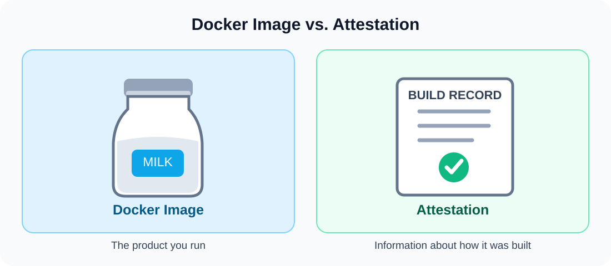
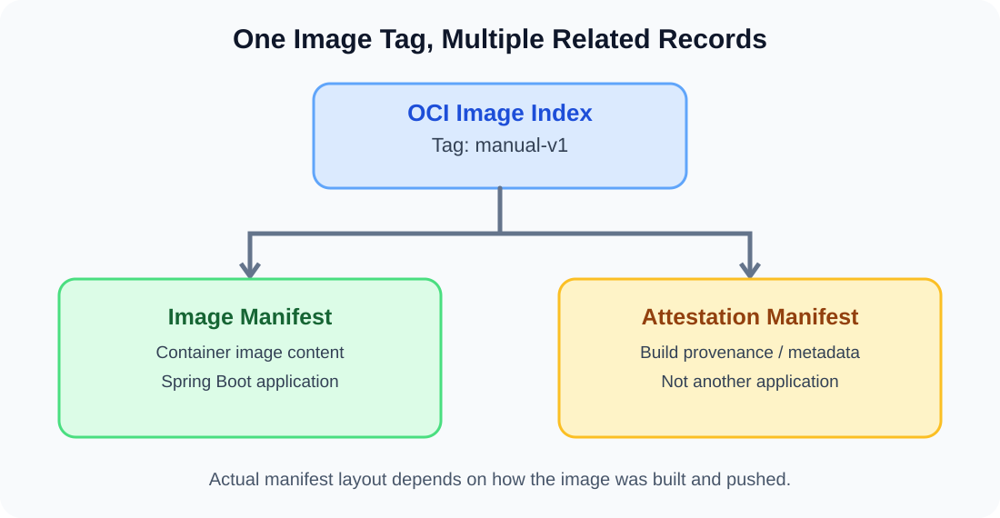
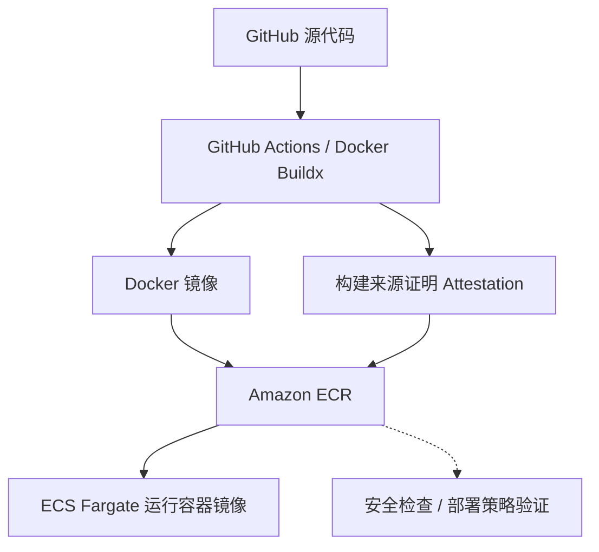

# Docker Attestation — 通俗易懂的解释
🌐 [English Version](attestation.md) | **简体中文**

> **一句话理解：** Docker Attestation 就像容器镜像的**生产履历证明**，可以帮助我们了解镜像从哪里来、是如何构建出来的。



## 1. Attestation 是什么？

**Attestation** 可以理解为“证明声明”或“用于提供证据的记录”。

在 Docker 中，它是与容器镜像相关联的一组**元数据（Metadata）**。其中常见的一种是**构建来源证明（Build Provenance Attestation）**，用于描述镜像的构建来源和过程。

你可以这样记：

- **Docker Image（容器镜像）**：真正要运行的软件产品。
- **Attestation（证明信息）**：描述这个产品如何被构建出来的记录。
- **Amazon ECR（镜像仓库）**：可以保存镜像及其关联证明信息的地方。

> **注意：** Attestation 并不天然等于权威认证。它包含的是声明；是否可信，还要核对来源、完整性，并在适用时验证签名。

## 2. 用一瓶牛奶来理解

假设你买了一瓶牛奶：牛奶是实际产品，而生产履历可能告诉你它来自哪家工厂、何时生产、经过怎样的生产流程。

| 牛奶生产 | Docker 构建 |
|---|---|
| 一瓶牛奶 | Docker Image |
| 生产工厂 | 构建环境，例如 GitHub Actions 或 MacBook |
| 生产日期 | 构建时间（如果有记录） |
| 生产工艺 | Dockerfile 和构建步骤（如果有记录） |
| 生产履历证明 | Build Provenance Attestation |

**关键区别：真正被执行的是 Docker Image，Attestation 本身不会作为应用运行。**

## 3. Attestation 可以记录什么？

具体内容取决于证明类型和构建配置，常见信息包括：

1. **来源（Source）**：使用了哪个代码仓库、哪个 Git Commit。
2. **构建者（Builder）**：由哪个工具或 CI 系统构建。
3. **构建过程（Build Process）**：使用了哪些输入和构建步骤。
4. **构建时间（Build Time）**：构建时间戳或其他时间相关信息。

描述软件产物**来源和构建过程**的信息，叫做 **Provenance（来源证明信息）**。

除此之外，还有其他类型的证明。例如 **SBOM（Software Bill of Materials，软件物料清单）** 可以列出软件包含的组件和依赖。

## 4. 为什么 Amazon ECR 中会出现三条记录？

在 `game-leaderboard-api` 实战中，向 AWS 悉尼区域的 ECR 上传 `manual-v1` 后，查询结果显示了镜像记录、Attestation 记录，以及带 `manual-v1` 标签的索引记录。



这是 Docker Buildx 常见的一种组织方式：

| 记录 | 作用 |
|---|---|
| **OCI Image Index** | 顶层索引，引用其他 Manifest，可能挂有 `manual-v1` 标签 |
| **Image Manifest** | 描述实际容器镜像及其各层 |
| **Attestation Manifest** | 承载或关联构建证明信息 |

**三条记录不等于部署了三个 Spring Boot 应用。** 实际 Manifest 结构会随着 Docker / Buildx 的构建和推送设置而变化。

### 实际命令：查看 ECR 镜像

查看详细信息：

```bash
aws ecr describe-images \
  --repository-name game-leaderboard-api \
  --region ap-southeast-2 \
  --output json
```

只查看带 Tag 的镜像：

```bash
aws ecr list-images \
  --repository-name game-leaderboard-api \
  --region ap-southeast-2 \
  --filter tagStatus=TAGGED \
  --output json
```

查看远端镜像索引和平台架构（需要 Docker CLI 和可用的仓库访问权限）：

```bash
docker buildx imagetools inspect \
  700922282419.dkr.ecr.ap-southeast-2.amazonaws.com/game-leaderboard-api:manual-v1
```

> 上述账号、仓库和镜像标签对应学习项目。其他 AWS 环境应替换成实际信息，**不要将 Access Key、Token 等凭证提交到 GitHub**。

## 5. 为什么 Attestation 很重要？

- **可追溯性（Traceability）**：追查镜像从哪里来。
- **安全检查（Security Checks）**：把声明的构建来源与企业允许的 CI 流程对比。
- **审计（Auditing）**：保存软件产物的构建依据。
- **软件供应链安全（Software Supply-chain Security）**：在验证证明信息的前提下，帮助发现异常构建来源。

**Attestation 不代表代码没有 Bug，也不代表镜像没有漏洞。** 实际上还需要结合签名验证、漏洞扫描、权限控制、依赖检查和 CI 测试。

## 6. 在 CI/CD 中处于什么位置？



## 7. 常见问题 FAQ

**Q：Attestation 是另一个 Docker 镜像吗？**  
不是。它是与镜像关联的元数据；根据镜像格式，可能在 ECR 中表现为单独的 Manifest 记录。

**Q：ECS Fargate 会运行 Attestation 吗？**  
不会。Fargate 运行实际应用容器；Attestation 主要用于检查和验证。

**Q：有 Attestation 就一定可信吗？**  
不一定。任何人都可能作出声明，必须使用适当的机制验证来源和完整性。

**Q：为什么部分镜像记录没有 Tag？**  
被带标签的 OCI Image Index 引用的子 Manifest，可能本身没有独立标签。

## 8. 技术面试怎么说？

**中文：**

> Attestation 就像 Docker 镜像的生产履历证明。它提供有关镜像来源和构建过程的信息，帮助开发者追溯构建记录，并提高软件供应链的可验证性和安全性。

**English：**

> Attestation is like a production certificate for a Docker image. It provides information about where the image came from and how it was built. It helps improve software supply-chain security.

**日语：**

> Attestationは、Dockerイメージのビルド元やビルドプロセスに関する情報を記録する証明データです。ソフトウェアサプライチェーンの追跡可能性と信頼性の向上に役立ちます。

## 9. 术语表

| 英文 | 中文 |
|---|---|
| Attestation | 证明声明 / 证明记录 |
| Provenance | 来源信息 / 构建来源证明 |
| OCI Image Index | 容器镜像索引 |
| Image Manifest | 镜像清单 |
| Attestation Manifest | 证明信息清单 |
| SBOM | 软件物料清单 |
| Amazon ECR | AWS 托管容器镜像仓库 |

## 10. 官方参考资料

- [Docker Docs — Build attestations](https://docs.docker.com/build/metadata/attestations/)
- [Docker Docs — Build provenance attestations](https://docs.docker.com/build/metadata/attestations/slsa-provenance/)
- [AWS Docs — Amazon ECR](https://docs.aws.amazon.com/AmazonECR/latest/userguide/what-is-ecr.html)

---

**练习项目：** `game-leaderboard-api`  
**主题：** Docker · AWS ECR · CI/CD · Software Supply-chain Security  
**建议 GitHub 路径：** `docker/attestation.zh-CN.md`
