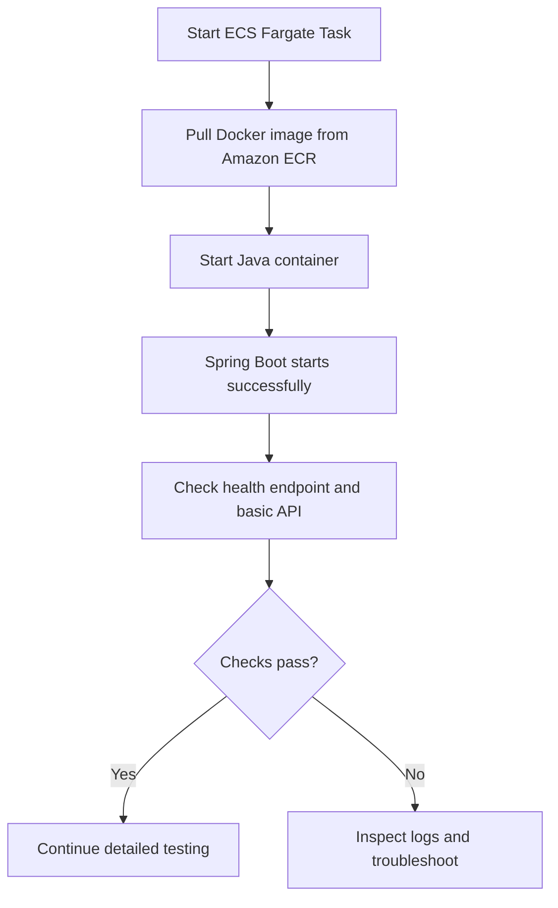
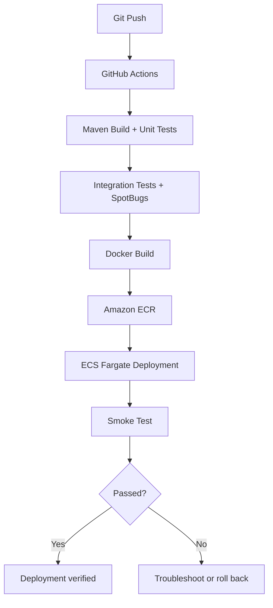

# Smoke Testing: A Simple Explanation

[简体中文](smoke-test.zh-CN.md)

> **In one sentence:** A smoke test is a quick check after a software build or deployment to make sure the application starts and its most important functions work before running more detailed tests.

## 1. Why Is It Called a “Smoke Test”?

The name comes from a simple idea in hardware testing: when you power on a new computer for the first time, you first check whether it turns on without a serious problem—such as smoke. If it fails immediately, there is little point in testing advanced features yet.

Software follows the same logic: **check for obvious, critical problems first, and run detailed tests afterward.**

## 2. Example: AWS ECS Fargate

Consider the Spring Boot project `game-leaderboard-api`. Its Docker image is stored in Amazon ECR, and we want to run it as an ECS Fargate task.



| Check | What success means |
| --- | --- |
| Image pull | Fargate downloads the image from ECR |
| Container start | The Java process starts |
| Application startup | Spring Boot finishes starting |
| Health check | The health endpoint reports a healthy state |
| Basic API | An important API request succeeds |

**Important:** Pulling an image or creating a container does **not** mean the whole smoke test has passed.

This project uses PostgreSQL, Redis, and Flyway. If the container starts but the application exits because it cannot connect to the database, part of the infrastructure check passed, but application startup did not.

## 3. Smoke Testing vs. Other Types of Testing

| Test type | Main goal | Example |
| --- | --- | --- |
| Unit Test | Check one small piece of logic | Is the player's score calculation correct? |
| Integration Test | Check components working together | Can Spring Boot read and write PostgreSQL data? |
| Smoke Test | Quickly check basic functionality | Does the deployed API start and respond? |
| Regression Test | Check that changes did not break existing behavior | Do existing APIs still work after adding Redis? |
| Performance Test | Measure speed and capacity | Response time under concurrent requests |

A smoke test **does not try to test everything**. It checks a small number of critical behaviors so the team can decide whether to proceed.

## 4. Where Smoke Testing Fits in CI/CD



## 5. Simple Spring Boot Health Check

If **Spring Boot Actuator** is installed and configured, the application can expose a health endpoint:

```http
GET /actuator/health
```

From an environment that can reach the application:

```bash
curl -f http://localhost:8080/actuator/health
```

A healthy response might look like this:

```json
{
  "status": "UP"
}
```

`UP` means the health endpoint reports a healthy state. **It does not prove that every business feature works.** A useful smoke test should also call at least one important application API. The command assumes the application is reachable on local port `8080`; if a Fargate security group blocks inbound traffic, use an appropriate internal verification method.

## 6. Key Takeaways

- Smoke testing is a **quick basic check after deployment**.
- Verify image pulling, container startup, application startup, and essential API behavior.
- If something fails, inspect the ECS task status and CloudWatch Logs.
- Smoke testing does not replace full integration, regression, or performance testing.

**Remember: smoke testing is like turning on a new computer for the first time. Check that it boots and performs basic actions before testing everything else.**