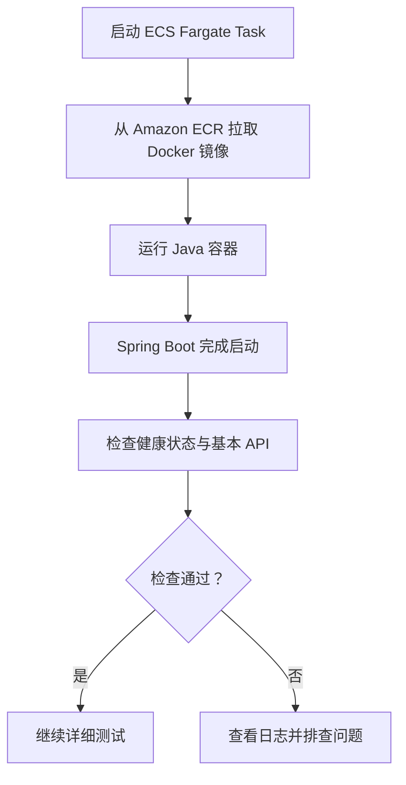
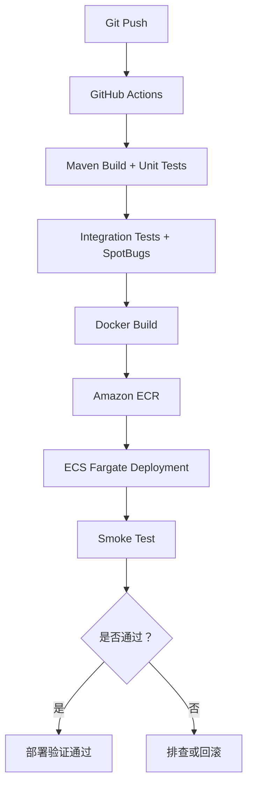

# Smoke Test（冒烟测试）：通俗易懂的解释

> **一句话理解：** 软件开发完成或部署后，先快速检查应用能不能正常启动、关键功能能不能使用，再决定是否进行更深入的测试。

## 1. 为什么叫“冒烟测试”？

这个名称来自电子硬件测试的形象说法：新电脑第一次接通电源，如果能正常开机、没有冒烟，才值得继续测试其他功能；如果刚通电就出严重故障，就应该先解决问题。

软件开发也是如此：**先排除明显的致命问题，再开展详细测试。**

## 2. 结合 AWS ECS Fargate 的实战例子

以 Spring Boot 项目 `game-leaderboard-api` 为例。应用的 Docker 镜像已上传 Amazon ECR，接下来使用 ECS Fargate 启动容器。



| 检查项目 | 通过条件 |
| --- | --- |
| 镜像拉取 | Fargate 成功从 ECR 下载镜像 |
| 容器启动 | Java 进程正常启动 |
| 应用启动 | Spring Boot 完成启动 |
| 健康检查 | 健康检查端点返回正常结果 |
| 基本 API | 一个关键 API 请求成功 |

**注意：** 镜像能拉取、容器能创建，不等于整个 Smoke Test 已通过。

本项目使用 PostgreSQL、Redis 和 Flyway。如果容器启动后因数据库连接失败而退出，说明运行环境的一部分已验证，但应用启动检查仍未通过。

## 3. Smoke Test 和其他测试的区别

| 类型 | 主要目的 | 例子 |
| --- | --- | --- |
| Unit Test（单元测试） | 检查单个功能 | 玩家分数计算是否正确 |
| Integration Test（集成测试） | 检查组件间的协作 | Spring Boot 能否读写 PostgreSQL |
| Smoke Test（冒烟测试） | 快速确认关键功能可用 | 部署后应用能否启动并访问 API |
| Regression Test（回归测试） | 检查更新是否破坏原有功能 | 增加 Redis 后原有 API 是否正常 |
| Performance Test（性能测试） | 检查性能和承载能力 | 并发请求下的响应时间 |

冒烟测试**不追求覆盖全部功能**，而是挑少量最重要的检查，快速判断是否值得继续测试。

## 4. Smoke Test 在 CI/CD 中的位置



## 5. 一个简单的 Spring Boot 健康检查示例

如果项目已加入并正确配置 **Spring Boot Actuator**，可以使用健康检查接口：

```http
GET /actuator/health
```

在可以访问应用的环境中执行：

```bash
curl -f http://localhost:8080/actuator/health
```

正常时可能得到：

```json
{
  "status": "UP"
}
```

`UP` 表示该端点报告的健康状态正常，**并不证明全部业务功能正常**。实际部署中还应至少调用一个关键业务 API。上述命令假定服务在本机 `8080` 端口可访问；如果 Fargate 安全组未开放入站连接，需要采用合适的内部验证方式。

## 6. 重要结论

- Smoke Test 是部署后的**快速基本检查**。
- 重点确认：镜像可拉取、容器可启动、应用可运行、关键接口可访问。
- 检查失败后先看 ECS Task 状态和 CloudWatch Logs。
- 它无法替代完整的集成测试、回归测试或性能测试。

**记忆方式：就像新电脑第一次开机，先确认它能正常启动和完成基本操作，再详细测试其他功能。**
